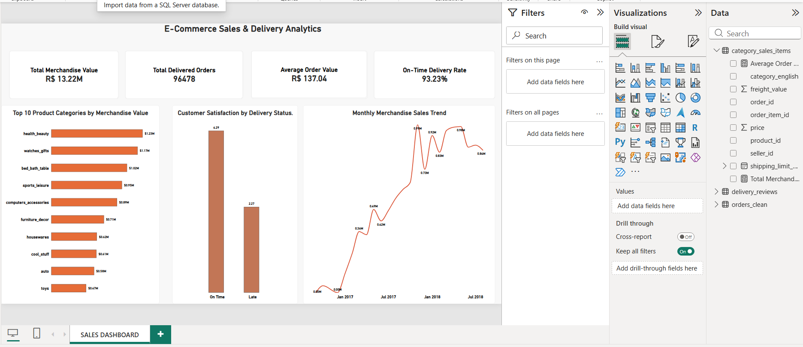

# E-Commerce Sales, Customer & Delivery Performance Analytics

## Project Overview

This project analyses the Olist Brazilian E-Commerce Public Dataset to understand sales performance, customer satisfaction, product category performance, and delivery efficiency.

Using Python, SQL, and Power BI, I cleaned and analysed transactional data, investigated business performance, and developed an interactive dashboard to communicate key findings.

The goal was to identify sales patterns, evaluate delivery reliability, and provide data-driven recommendations for improving business operations and customer experience.

## Business Questions

1. How much merchandise value was generated from delivered orders?
2. How did monthly sales change over time?
3. Which product categories generated the highest merchandise value?
4. What percentage of eligible delivered orders arrived on time?
5. How was delivery performance associated with customer satisfaction?
6. Which Brazilian states experienced the highest delivery delays?

## Tools and Technologies

- **Python:** Data cleaning, exploratory analysis, and data preparation
- **Pandas:** Data manipulation and aggregation
- **SQLite and SQL:** Business queries and data validation
- **Power BI:** Interactive dashboard development
- **Jupyter Notebook / VS Code:** Analysis and documentation

## Dataset

**Source:** [Olist Brazilian E-Commerce Public Dataset](https://www.kaggle.com/datasets/olistbr/brazilian-ecommerce)

The dataset contains approximately 100,000 orders and includes customer information, order items, payments, reviews, products, sellers, and delivery records.

The analysis primarily focuses on delivered orders.

## Data Cleaning and Preparation

Key preparation activities included:

- Examining missing values and duplicate records
- Converting order timestamps into datetime formats
- Validating relationships between datasets
- Calculating delivery durations and delivery status
- Aggregating customer reviews at the order level
- Combining product information with English category translations
- Creating cleaned datasets for SQL and Power BI

Records with missing product categories were preserved rather than automatically deleted.

## Key Performance Indicators

| Metric | Result |
|---|---|
| Delivered Orders | 96,478 |
| Delivered Merchandise Value | R$13,221,498.11 |
| Average Order Value | R$137.04 |
| Eligible Orders for Delivery Analysis | 96,470 |
| On-Time Delivery Rate | 93.23% |
| Average Delivery Time | 12.56 days |
| Late Deliveries | 6,534 |

## Key Findings

### 1. Sales Performance

Delivered-order merchandise value totaled approximately R$13.22 million.

For January–July, merchandise value increased by 161.59% from 2017 to 2018.

The increase was primarily associated with higher delivered-order volume rather than a substantial change in average order value.

### 2. Product Category Performance

The leading product categories by delivered merchandise value were:

- Health & Beauty — R$1.23 million
- Watches & Gifts — R$1.17 million
- Bed, Bath & Table — R$1.02 million
- Sports & Leisure — R$954,852.55
- Computers & Accessories — R$888,724.61

The top 10 categories contributed approximately 62.43% of total delivered merchandise value.

### 3. Delivery Performance

Approximately 93.23% of eligible delivered orders arrived on or before their estimated delivery dates.

Delivery reliability varied across Brazilian states, indicating opportunities for targeted logistics improvements.

### 4. Customer Satisfaction

Among delivered orders with available reviews:

| Delivery Status | Average Review Score | Low-Rating Percentage |
|---|---|---|
| On Time | 4.29 | 9.23% |
| Late | 2.27 | 62.36% |

Late deliveries were strongly associated with lower customer review scores.

These findings indicate an association, not proof that delivery delays caused the lower ratings.

### 5. Data Quality

Some product categories were missing or lacked English translations.

These records were retained to avoid understating merchandise value.

## Business Recommendations

1. **Improve delivery reliability:** Investigate logistics processes in states experiencing relatively high late-delivery rates.
2. **Prioritize customer experience:** Monitor delivery delays alongside customer review scores.
3. **Support leading categories:** Use sales volume and merchandise value together when evaluating product category performance.
4. **Monitor growth:** Track monthly merchandise value, order volume, and average order value to understand changes in business performance.
5. **Improve data quality:** Strengthen product categorization and maintain accurate delivery records.

## Power BI Dashboard

The dashboard includes:

- Total Merchandise Value
- Total Delivered Orders
- Average Order Value
- On-Time Delivery Rate
- Top 10 Product Categories by Merchandise Value
- Customer Satisfaction by Delivery Status
- Monthly Merchandise Sales Trend

The Power BI dashboard screenshot is available in the powerbi folder. 
The editable .pbix project file is maintained locally.

## Project Limitations

- The dataset does not provide complete product costs, refunds, or profit information.
- Merchandise value should not be interpreted as net revenue or profit.
- Some records contain missing delivery information.
- Early historical months have sparse coverage, while the final period may be incomplete.
- Customer review patterns demonstrate associations rather than causal relationships.

## Conclusion

This project demonstrates how Python, SQL, and Power BI can be combined to transform raw e-commerce data into useful business insights.

The analysis highlights the importance of sales volume, product category performance, delivery reliability, and customer satisfaction in evaluating e-commerce operations.
